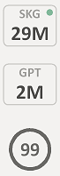
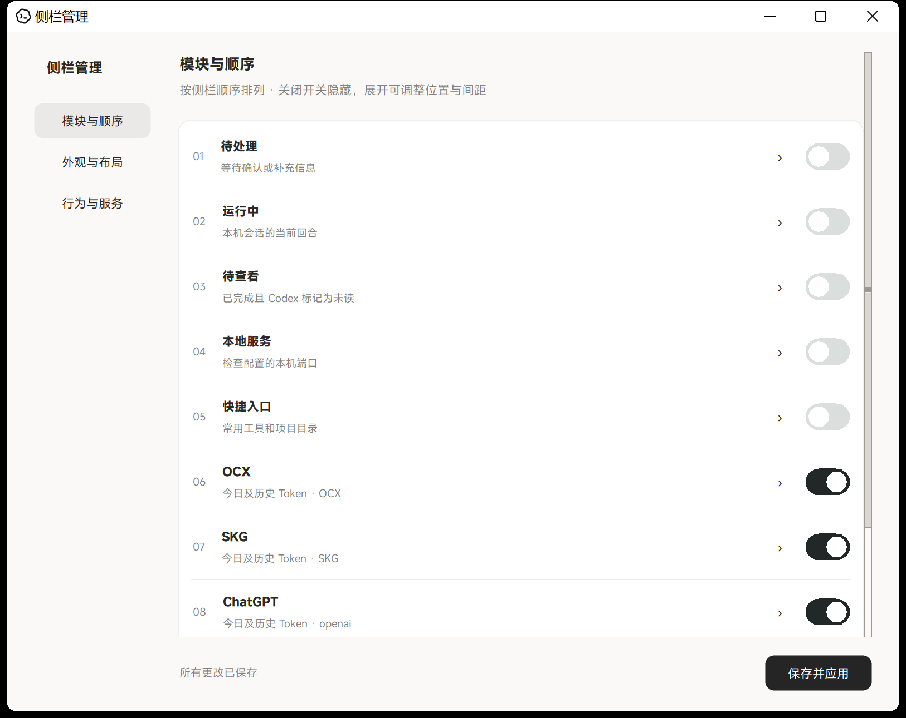
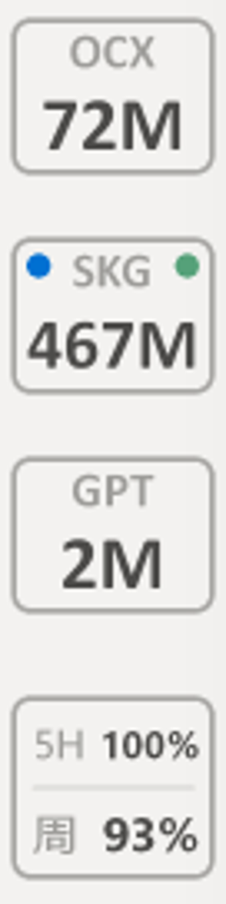
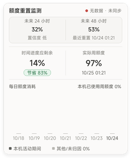

# Codex Quota Badge

 

> 在 Codex 侧栏一眼看到本机用量、周额度、运行状态和重置信号。

Codex Quota Badge 是一个轻量的本地侧栏伴随工具，面向需要同时管理 Codex / OpenCodex 多个 provider、多个设备和原生子代理的开发者。它支持 Windows、Intel Mac 和 Apple Silicon Mac，默认只读取本机数据，不修改 Codex 安装、不读取模型密钥，也不发起模型请求。

[下载最新版本](https://github.com/yydeclx/codex-quota-badge/releases/latest) · [查看更新记录](https://github.com/yydeclx/codex-quota-badge/releases) · [提交问题](https://github.com/yydeclx/codex-quota-badge/issues)

> 当前最新版本：**[v1.5.4](https://github.com/yydeclx/codex-quota-badge/releases/tag/v1.5.4)**

## v1.5.4 更新

- 修复 OpenCodex CLI 将 aggregation 放在 quota 同级时周额度变成横杠的问题，兼容旧格式
- 当前账号与账号池分别使用成对的额度、重置和时间戳，避免混合口径；当前账号无 5 小时窗口时保持缺省
- 重置监测断网后复用现有心跳进行有上限退避重试，成功恢复正常 15 分钟周期，失败保留缓存

## v1.5.3 更新

周额度归因统一为本机、非本机两项。缺少证据时，按本机用量/活动、采样间隔和历史比例估算归因，日期断档按可能时间段分摊。两色柱状图、悬停及状态中心使用同一账本，日/周期/来源总量和显示舍入均闭合；旧历史备份后迁移。[算法说明](docs/QUOTA-ATTRIBUTION.md)

## v1.5.2 更新

补齐 v1.5.1 发布时遗漏的、已在本机完成的修改：底部相关会话改为单行，标题加大加粗，右侧模型胶囊保留来源前缀并使用轻微阴影；列表宽 280 DIP、行高 30 DIP，长标题优先省略。另补齐额度读取失败后的有限重试、退避恢复与诊断状态。保留 v1.5.1 的 owned popup 布局、悬停和升级迁移修复。

## v1.5.1 更新

正式支持 Windows owned popup 兼容模式，修复水平偏移不生效、Token 右边框裁切和悬停信息卡无法打开。普通电脑仍默认使用透明子窗口；兼容电脑的模式选择保存在独立的 `window-mode.json`，安全更新会迁移旧监督器里的兼容入口并保留配置与历史。

仅在原始透明子窗口不可见的电脑上选择兼容模式，详见 [安装与更新说明](PORTABLE-INSTALL.md#windows-窗口兼容模式)。本版不更改 Token 和周额度样式，不包含新的网关二进制；已有可选补丁文件保留。

## v1.5.0 更新

修复额度日期与来源归因、每日总量堆叠、管理页与状态中心、负间距和滚动显示；减少后台无效工作，补齐发布依赖。当前界面保持已部署设计，不包含设计示例。

普通包约 202 KB；可选 OpenCodex 2.92.0 Windows x64 补丁附件需单独下载并显式启用。新装默认关闭补丁，原有安装保留配置与历史。[安装与更新说明](PORTABLE-INSTALL.md)

## 你可以看到什么

| 模块 | 内容 |
| --- | --- |
| Provider 用量 | ChatGPT、OpenCodex、ABC 和其他已配置 provider 的本机 Token 用量 |
| 周额度 | 剩余百分比、重置时间，以及 Pro / Plus 兼容数据 |
| 运行状态 | 主会话和原生子代理按实际模型路由显示绿色运行指示 |
| 重置监测 | 明确信号优先；没有信号时显示 24 小时和 48 小时预测 |
| 本机归因 | 结合额度采样和本机活动估算本机与其他设备的消耗 |
| 管理与更新 | 模块排序、布局微调、样式预览和 GitHub Release 自动更新 |

## 预览

### 侧栏状态

侧栏模块保持紧凑，运行指示、完成未读和额度状态彼此独立；多个 provider 或子代理并行时可以同时观察。

### 管理窗口

管理窗口支持模块开关、排序、模块间距、底部留白、水平偏移、Token 样式和周额度样式预览。

### 周额度与重置监测

重置监测显示公开数据的新鲜度；账号额度变化会进一步用于确认是否真的完成重置。截图中的数值是示例数据，不代表账号账单。

## 快速安装

1. 打开[最新 Release](https://github.com/yydeclx/codex-quota-badge/releases/latest)
2. 下载对应平台的 ZIP 包并解压到固定目录
3. Windows 运行 ~install.ps1~ 或 ~start.ps1~
4. 打开 Codex，侧栏会自动附着到主窗口
5. 右键侧栏进入“侧栏管理”，调整模块和位置

Windows 脚本使用 PowerShell 7。首次安装、跨电脑配置和更新保留规则请参考 [PORTABLE-INSTALL.md](PORTABLE-INSTALL.md)。

## 配置示例

~sidebar-config.json~ 控制模块顺序和布局：

~~~json
{
  "refreshSeconds": 60,
  "items": [
    {"id": "provider_abc", "type": "opencodex_today", "provider": "ABC", "label": "ABC", "enabled": true, "gapAfter": 3},
    {"id": "weekly_quota", "type": "weekly_quota", "label": "周额度", "enabled": true, "gapAfter": 0}
  ],
  "quotaStyle": "01",
  "bottomOffset": 82,
  "horizontalOffset": 0,
  "activityEnabled": true
}
~~~

| 字段 | 作用 |
| --- | --- |
| ~items~ | 模块顺序、显示名称和启用状态 |
| ~refreshSeconds~ | 本机用量刷新间隔，范围 30–3600 秒 |
| ~quotaStyle~ | 周额度显示样式 |
| ~bottomOffset~ | 侧栏底部留白 |
| ~horizontalOffset~ | 适配不同侧栏宽度的左右偏移 |
| ~activityEnabled~ | 开关运行绿点和活动状态读取 |

## 数据口径与隐私

- Token 用量来自本机 OpenCodex usage 数据，不代表账号在其他电脑上的完整账单
- 周额度来自本机可用的 Codex / OpenCodex 额度接口
- 多台设备同时使用同一账号时，本机归因只能是采样估算，无法从官方周额度接口精确拆分
- 重置监测使用公开的只读预测和信号数据，并缓存最后一次成功结果
- 插件不保存模型正文、密钥或管理员令牌
- 状态中心只读取脱敏快照，诊断复制使用字段白名单
- 普通侧栏安装与更新不会切换 OpenCodex 网关，也不会发送模型请求；仅显式开启或关闭可选实时指标补丁时，才校验并切换受支持的 2.92.0 网关

## 自动更新

从 v1.3.8 开始，安装包包含 GitHub Release 更新器。它会定期检查最新 Release，下载完整 ZIP，校验 SHA256，再替换程序文件。更新时保留每台电脑自己的配置、额度历史、连接历史和账号状态；更新失败会保留旧版本。

本项目同时使用：

- Git 提交：保存源码历史和差异
- Git tag：标记源码版本，例如 ~v1.5.0~
- GitHub Release：提供可安装 ZIP 和校验值

## 开发与验证

~~~powershell
python -m unittest test_update_client test_reset_signals test_quota_windows test_sidebar_activity test_modules test_provider_indicators test_sidebar_data test_power_mode test_stability
python -m py_compile *.py
~~~

测试覆盖额度解析、OpenCodex 兼容、子代理运行指示、DPI 布局、缓存、后台省电、管理页和更新器。

## 故障排查

### 侧栏没有显示

运行 ~start.ps1~，确认 Codex 主窗口已经打开；也可以运行 ~manage.ps1~，在管理窗口中点击“启动 / 恢复侧栏”。

### 额度显示为破折号

破折号表示读取失败、数据过期或当前没有可用结果。插件会优先保留上一次成功数据，避免休眠后短暂闪烁为破折号。

### 其他电脑没有自动更新

确认插件版本至少为 v1.3.8，~update-config.json~ 中 ~enabled~ 为 ~true~，并且电脑可以访问 GitHub API 和 Release 下载地址。默认检查周期为 6 小时。

### 高 DPI 下位置不齐

在“侧栏管理 → 外观与布局”中调整“水平偏移”和“底部留白”。正数向右移动，负数向左移动。

## 相关文档

- [便携版安装与跨电脑更新](PORTABLE-INSTALL.md)
- [功能验收记录](FEATURES-QA.md)
- [活动状态实现说明](ACTIVITY-IMPLEMENTATION.md)
- [侧栏管理技能说明](skills/sidebar-management/SKILL.md)
- [所有 Releases](https://github.com/yydeclx/codex-quota-badge/releases)

## 免责声明

这是一个社区维护的本地伴随工具，不是 OpenAI、Codex 或 OpenCodex 官方组件。客户端更新可能改变窗口结构、额度接口或本地数据格式；遇到接口变化时，相关模块可能暂时显示缓存、过期或不可用状态。

## License

当前仓库尚未提供独立 LICENSE 文件。若要长期对外维护，建议补充明确的开源许可证。

